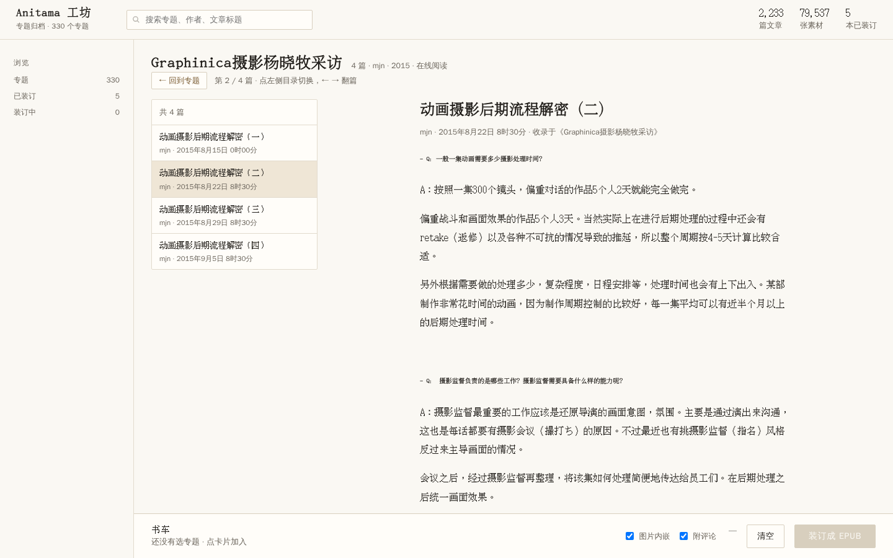

# Anitama 装订台

把 [Anitama-Backup-2020](https://archive.org/details/Anitama-Backup-2020) 归档里的专题装订成 EPUB，并且可以直接在浏览器里在线阅读。

Rust（axum）单文件服务 + 零依赖静态前端，没有数据库、没有 Node 构建步骤。默认监听 `127.0.0.1:8095`。




## 它能做什么

- **浏览与检索**：330 个专题 / 2,233 篇文章，按关键词、栏目、作者、年份筛选，按装订状态（已装订 / 未装订）过滤
- **装订 EPUB**：勾选若干专题（可跨分页一键全选筛选结果）→ 串行装订，实时看进度与日志，完成后直接下载
  - 正文图片内嵌、文末附评论区、自动生成 1200×1800 封面；每个专题一本，输出到 `<归档根>/epubs/`
  - 「图片内嵌」不勾选时正文去掉图片元素、包里也不写任何图片文件（纯文本，体积很小）
- **在线阅读**：不进 EPUB 也能在浏览器里读全文——左侧篇章目录、上/下篇、键盘 `←` `→` 翻篇、`Esc` 返回，地址是 `#read/<专题>/<文章>` 可分享可前进后退；正文里指向其它文章的链接也在阅读器内打开
- **已装订列表**：列出 `epubs/` 里的成品（专题号、体积、时间、下载）

## 需要什么数据

工具本身不带任何内容，运行时需要一个「归档根目录」，目录下要有：

| 目录 | 必需 | 说明 |
| --- | --- | --- |
| `Anitama-Backup/` | ✅ | 阅读站快照，约 43 GB。用到的部分：`series/`（365 个专题目录）、`article/`（6,840 篇 html）、`cdn/`（6,839 个素材目录）、`channel/`、`static/`、`index.html` |
| `originals/comment/` | ⭕ 可选 | 5,683 个 `*.json`。只有勾选「附评论」时才读；没有就只是装订出来的书没有评论区 |
| `epubs/` | 输出 | 不存在会自动创建；**进程要对它有写权限**，成品放这里 |
| `Articles/`、`Media Files/`、`Miscellaneous/`、`_metadata/`、`cdn-7z-volumes/` | ❌ | 原始归档与元数据，运行不需要（`README.txt` 里有原始说明） |

目录布局：

```
<归档根>/
├── Anitama-Backup/      ← 必需
│   ├── series/          ← 专题页
│   ├── article/         ← 文章页
│   └── cdn/             ← 正文图片、封面
├── originals/           ← 可选（comment/ 用于评论区）
├── epubs/               ← 输出（自动创建）
└── webui/               ← 本仓库的代码
```

数据来源：archive.org 的 **Anitama-Backup-2020**（站点内容 CC BY-NC-SA 4.0）。把归档解到任意位置，启动时把「归档根目录」作为第一个参数传进来即可。

> 字符集提醒（沿用归档自带的 `README.txt`）：归档 html 是 UTF-8，但部分页面没写 `<meta charset>`。本工具的接口自己产出 JSON、不受影响；如果你另外用静态服务挂 `Anitama-Backup/` 原站，记得显式发 `text/html; charset=utf-8`，否则中文会按 GBK 猜。

## 环境要求

- **Rust**（stable，rustup 安装的话 `cargo` 在 `~/.cargo/bin`；有些发行版包管理器装的叫 `rustc`/`cargo` 分开的包）
- **中文字体**：封面用系统字体渲染，服务器上没有中文字体时封面会缺字。检查：`fc-list :lang=zh | head`，没有就装（如 `fonts-noto-cjk` / `wqy-zenhei`）
- 不需要 Node、数据库、反向代理（局域网直连即可）

## 快速开始

```bash
git clone <你的仓库地址> anitama-epub
cd anitama-epub/webui
cargo build --release

# 第一个参数是「归档根目录」（省略则用当前目录）
./target/release/anitama-epub-web /path/to/archive-root
# 打开 http://127.0.0.1:8095/
```

或者用附带的脚本（自动挑 release/debug 二进制、已在跑就跳过、起完等就绪）：

```bash
./start.sh /path/to/archive-root 8095     # 端口可省，默认 8095
BIND=127.0.0.1 ./start.sh                 # 只给本机用
```

启动时会先扫一遍归档（330 个专题 / 79,537 个素材），**约 4~7 秒后才开始监听端口**，属正常。

## 配置

全部通过环境变量，没有配置文件：

| 变量 | 默认 | 说明 |
| --- | --- | --- |
| `BIND` | `127.0.0.1` | 监听地址。要让局域网访问就设 `0.0.0.0` |
| `PORT` | `8095` | 端口 |
| `STATIC_DIR` | `<归档根>/webui/static`，不存在时退到 `./static` | 前端静态目录。**归档根与仓库不在同一个目录时必须显式设置**（否则页面 404） |
| `RUST_LOG` | `info,anitama_epub_web=debug` | 日志级别 |

归档根目录只从命令行第一个参数读（默认当前目录）。

## 部署

### systemd 用户服务（推荐）

`webui/anitama-epub.service` 是模板，把路径换成你自己的：

```ini
[Unit]
Description=Anitama 装订台（EPUB 生成 + 在线阅读）
After=network.target

[Service]
Type=simple
WorkingDirectory=/path/to/anitama-epub/webui
ExecStart=/path/to/anitama-epub/webui/target/release/anitama-epub-web /path/to/archive-root
Environment=PORT=8095
Environment=BIND=0.0.0.0
Environment=STATIC_DIR=/path/to/anitama-epub/webui/static
Restart=on-failure
RestartSec=3

[Install]
WantedBy=default.target
```

```bash
cp webui/anitama-epub.service ~/.config/systemd/user/
systemctl --user daemon-reload
systemctl --user enable --now anitama-epub
systemctl --user status anitama-epub          # 看状态
journalctl --user -u anitama-epub -f          # 看日志
loginctl enable-linger "$USER"                # 不登录也开机自启
```

更新：

```bash
git pull && (cd webui && cargo build --release) && systemctl --user restart anitama-epub
```

### 反向代理（可选）

SSE 进度接口要关掉缓冲，否则进度会攒着一次性吐出来：

```nginx
location /anitama/ {
    proxy_pass http://127.0.0.1:8095/;
    proxy_http_version 1.1;
    proxy_set_header Host $host;
    proxy_buffering off;            # /api/jobs/:id/stream 需要
}
```

### 接到导航页（可选）

如果用 [homepage](https://gethomepage.dev/)，在 `services.yaml` 里加一条：

```yaml
    - Anitama 装订台:
        icon: mdi-book-open-page-variant
        href: http://<主机>:8095
        description: 专题归档 · 装订 EPUB
        siteMonitor: http://127.0.0.1:8095/api/state
```

## 仓库结构

```
webui/                   服务本体
├── src/main.rs          axum 路由、SSE 进度、封面与下载响应、启动
├── src/archive.rs       扫描归档 → 专题列表；缩略图缓存；已装订列表
├── src/html.rs          解析专题页/文章页/评论；改写正文里的图片与链接
├── src/epub.rs          EPUB3 打包（OPF + nav + NCX + 正文 + 评论 + 样式）
├── src/cover.rs         用 image + rusttype 画封面
├── src/jobs.rs          装订队列（串行）、进度广播、产出清单
├── src/util.rs          转义、时间解析、文件名清洗、图片类型嗅探
├── static/              前端（原生 JS，无构建工具、无外部依赖）
├── start.sh             启动脚本
├── anitama-epub.service systemd 用户服务模板
└── README.md            开发者向细节（接口表、模块职责、踩坑）
make_epubs.py            同功能的 Python 参考实现（最早的版本，保留备查）
design-webui/            设计过程：三个方向页 a/b/c、阅读器效果图 d-reader/d-entry
docs/                    README 用的截图
README.txt               归档自带的目录说明（数据来源、完整性、字符集）
```

## HTTP 接口

| 方法 | 路径 | 说明 |
| --- | --- | --- |
| GET | `/api/state` | 统计、专题列表（含每本的第一篇 id）、任务、已装订 |
| GET | `/api/series/:sid` | 单个专题（含收录文章清单） |
| GET | `/api/cover/:sid?w=660` | 专题横幅缩略图（JPEG，带缓存头） |
| GET | `/api/read/:aid` | 一篇文章的正文（已改写资源地址，供在线阅读） |
| GET | `/media/*path` | 归档里的图片/视频封面（带一天缓存，拒绝 `..` 越权） |
| GET | `/api/epubs` | `epubs/` 里的成品 |
| GET/POST | `/api/jobs` | 任务列表 / 新建装订任务 `{sids, embed_images, comments}` |
| GET | `/api/jobs/:id` | 单个任务 |
| GET | `/api/jobs/:id/stream` | SSE 进度（先发快照，再推增量） |
| POST | `/api/rescan` | 重新扫描归档 |
| GET | `/epub/:name` | 下载成品 |

## 常见问题

- **页面 404 / 只有 JSON 没有界面**：`STATIC_DIR` 没指对。归档根 ≠ 仓库根时必须显式设置。
- **启动后连不上**：正常，要等 4~7 秒扫完归档才开始监听；`journalctl --user -u anitama-epub -f` 会打印「装订台已就绪 → http://…」。
- **`cargo: command not found`**：rustup 装在 `~/.cargo/bin`，用绝对路径或 `export PATH="$HOME/.cargo/bin:$PATH"`。
- **封面缺字 / 方框**：装中文字体（`fc-list :lang=zh`）。
- **正文图片 404**：归档的 `cdn/` 不完整；阅读器会把加载失败的图从 DOM 摘掉，不留破图标。
- **装订失败、报权限**：`epubs/` 要可写（systemd 用户服务以你的身份跑，一般没问题）。
- **端口被占**：`PORT=8096 ./start.sh`，或改 unit 里的 `Environment=PORT=`。

## 数据来源与许可

- 站点内容（`Anitama-Backup/`、`originals/`）来自 archive.org 的 **Anitama-Backup-2020**，按 **CC BY-NC-SA 4.0** 授权，版权归原作者与 Anitama 所有；本仓库不含这些数据，请自行获取并遵守其许可。
- **本仓库的代码**（`webui/`、`make_epubs.py`、`docs/` 截图等）按 **MIT** 授权，见 [LICENSE](LICENSE)。
- 代码与数据的许可是分开的：MIT 只覆盖本仓库的代码，不覆盖站点内容和导出的 EPUB 内容。
